# Mimicking Erosion with Cosine Gullies: Deriving Analytical Derivatives

## Introduction

Procedural terrain generation is an integral aspect of video-games, movies, and simulations, allowing programs to algorithmically create billions of possible digital environments with convincing terrain layouts based on a set of described parameters (Doran and Parberry). Most terrain generators utilize gradient noise algorithms which can reproduce the random, non-repeating yet continuous property of real-world terrain, yet are limited in replicating other phenomena responsible for many unique structures found in nature. One example is erosion, which is responsible for gorges and gullies evident in mountain ranges. Because erosion is pivotal in shaping mountains, simple noise functions often produce lackluster results. Some programs create an erosion effect by simulating the movement of thousands of water droplets over time. This produces realistic results, yet is computationally intensive and cannot be used in chunk based generation because of its dependence on neighboring terrain. Another solution is to mimic erosion by algorithmically generating gullies using cosine waves. Though not based on physics, it produces convincing terrain and is comparatively cheaper to compute and entirely position dependent. This paper will investigate the mathematics behind the erosion-mimicking algorithm, specifically the use of analytical derivatives in shaping the terrain.

The aim of this investigation is to mathematically derive an equation which produces erosion gullies, along with its partial derivatives, as a function of position in 2D space. The erosion algorithm depends on a base terrain layer that it is applied to, in this case, a 2D noise function (simplex gradient noise) with known partial derivatives. This procedure is heavily inspired by the work of Rune Skovbo Johansen, also known online as runevision, specifically his YouTube video on this topic (Johansen), which this investigation explores in further detail, particularly in exploring the multivariable differentiation.

## Base Terrain Mesh Structure

The basic method for creating terrain involves a 2D grid of vertices arranged in a mesh, each with a 3D vertex position vector $\vec{V} = \langle x, y, z \rangle$, with $x$, $y$, and $z$ being the coordinates of the vertex. Importantly, the $x$ and $y$ axis represent the horizontal axises, with the $z$ axis being vertical.

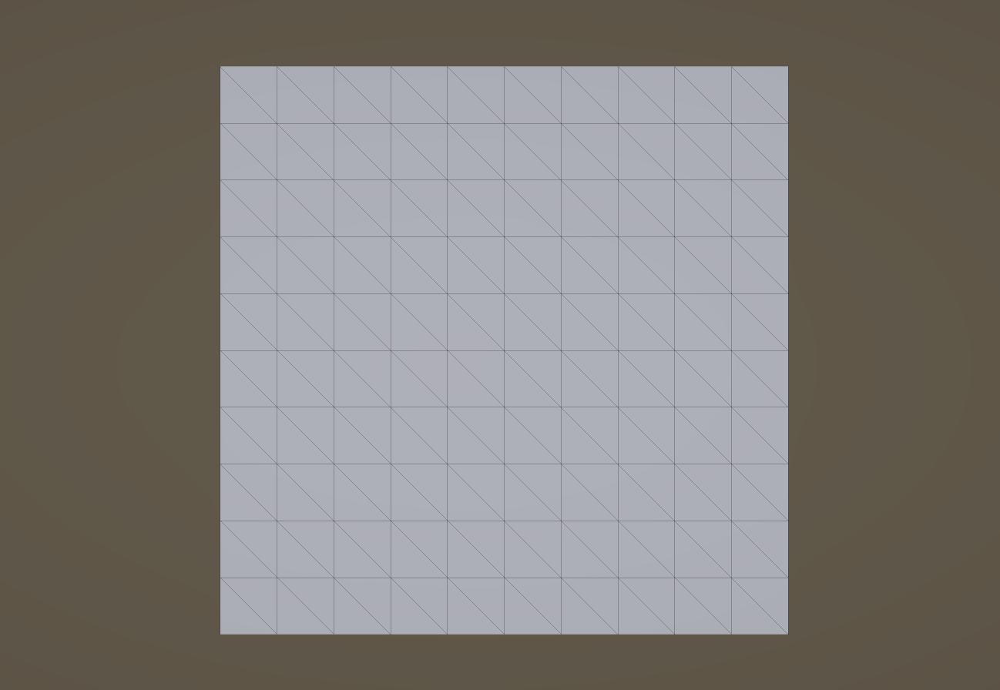

**Figure 1:** 10x10 Mesh with visible wireframes showcasing the structure of a mesh using vertices arranged in a grid.

Given a 2D terrain function $S(\vec{p})$, the height of each vertex is determined by the output of this function, with the 2D horizontal position $\vec{p} = \langle x, y \rangle$ of each vertex being the input. In general, we can visualize 2D functions through images. For example, a gradient noise function like simplex noise can be represented with the following image, with the input being $\vec{p}$, and the output being the brightness (white = 1, black = 0).

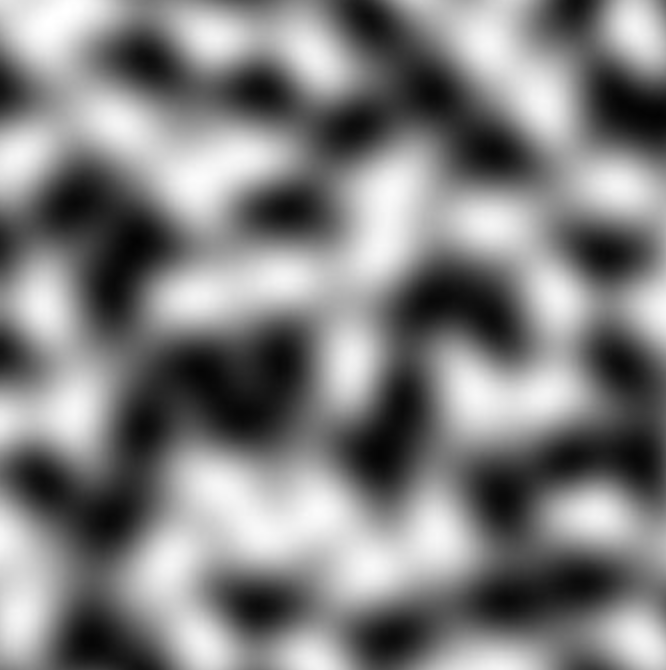

**Figure 2:** Visualizing the 2D Simplex Noise function $S(\vec{p})$ through a 2D image, with the output range [-1, 1] visualized with brightness (Sharpe).

The simplex noise algorithm $S(\vec{p})$, a form of gradient noise, will be the base terrain layer which the erosion will be applied to. Gradient noise functions utilize pseudo-random gradients which are interpolated to create smooth fading between non-repeating values. This is immensely useful for avoiding repetition while maintaining the property of being continuous and differentiable. 

In this case, if the $z$ position of each vertex is offset by the output of the simplex noise function, then the terrain generates to look like this:

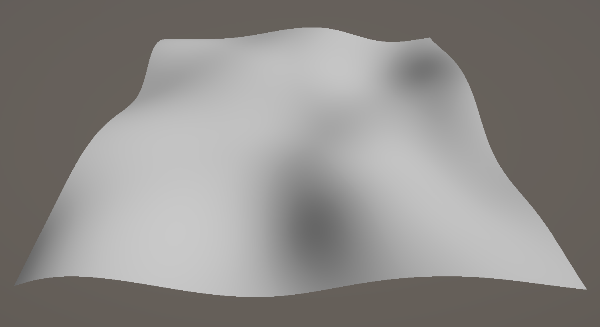

**Figure 3:** Mesh when offsetting the $z$ position of each vertex based on the output of the simplex noise function $S(\vec{p})$ at the respective horizontal position of each vertex.

With this method, any 2D function can be used to offset the vertices and create a heightmap for terrain. Thus, we can create an additional function that outputs a heightmap based on an erosion mimicking algorithm. Therefore, given this erosion function $E(\vec{p})$, the vertex position can be represented as:

$$\vec{V} = \langle x, y, S(\vec{p}) + A_E \cdot E(\vec{p}) \rangle \quad (1)$$

where $A_E$ is the erosion amplitude, or in other words, the strength that the erosion will affect the height.

## Generating Cosine Gullies

The erosion algorithm works by creating cosine gully offsets that run down the slope of the base terrain. Essentially, the pathway downwards should have the same phase $\phi$, so that the gully runs through that pathway like water runs down terrain. The $\phi$ axis of the function is therefore perpendicular to the downwards gradient. This procedure can be stacked multiple times, with each iteration utilizing the gradients created by the previous. This results in branching gully patterns similar to real-life.

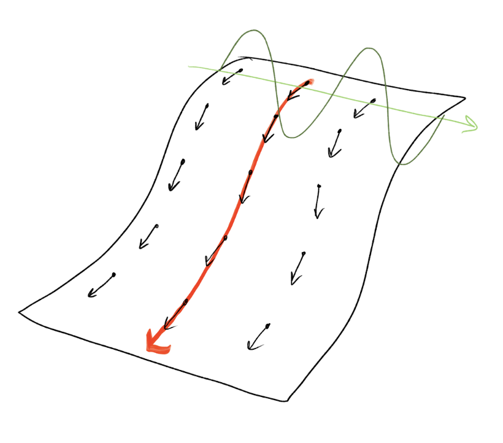

**Figure 4:** Visualizing the use of a cosine function on a sloping terrain to create downward flowing gullies, with the phase axis perpendicular to the gradient being represented by the light-green arrow and the resulting gully direction represented by the red arrow.

To get this effect, we need the gradient vector, which is obtained through the partial derivitives $\delta x$ and $\delta y$ given by $\nabla S(\vec{p})$ to yield $\vec{g} = \nabla S = \langle \delta x, \delta y \rangle$, where $\vec{g}$ is the gradient vector. For 2D multivariable functions, the gradient vector is a vector with the components $\delta x$ and $\delta y$, which represent the slope in the $x$ and $y$ direction respectively. This can be visualized by coloring the terrain based on the gradient, with red being represented by $\delta x$ and green by $\delta y$.

**Figure 5:** Visualizing the gradient vector $\vec{g}$ by coloring the terrain based on the partial derivatives $\delta x$ and $\delta y$ which are displayed by the red and green value respectively. 

Using $\vec{g}$, the perpendicular unit vector tangent to the terrain $\hat{d}$ can be obtained.

$$\vec{d} = \langle -\delta y, \delta x \rangle \quad \hat{d} = \frac{\vec{d}}{\Vert \vec{d} \Vert } \quad (2)$$

Deriving $\phi$ requires the dot product between $\vec{p}$ and $\hat{d}$. This is because, as established before, moving along the ascent gradient should yield the same result for $\phi$. Because the dot product between perpendicular vectors is 0, the moving perpendicular to $\hat{d}$ will leave the dot product unchanged. Although $\vec{p}$ represents a position on the mesh with reference to some reference point, it is useful to establish our own reference point as well, denoted as $\vec{c}$. This allows us to change the pivot of our dot product, which will become more useful later. This yields the equation:

$$\phi = 2\pi f(\vec{o} \cdot \hat{d}), \quad \vec{o} \equiv \vec{p} - \vec{c} \quad (3)$$

where $f$ is a constant representing the frequency of the cosine function. Notably, $\phi$ is multiplied by $2\pi f$ to yield a wave with a period of $1/f$.

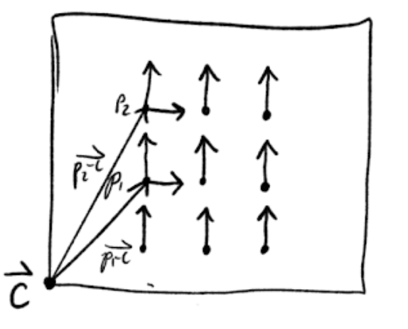

**Figure 6:** Visualizing the dot product $\vec{o} \cdot d$ and how the dot product yields the same value along the gradient vector.

With $\phi$, the gully height is determined through $\cos(\phi)$. When applying this to a mesh with a constant gradient, it yields evenly spaced cosine gullies which run down the slope of the terrain.

Overall, the gully height as a function of position $G(\vec{p})$ can be represented as:

$$G(\vec{p}) = \cos(2\pi f(\vec{o} \cdot \hat{d})) = \cos(\phi) \quad (4)$$

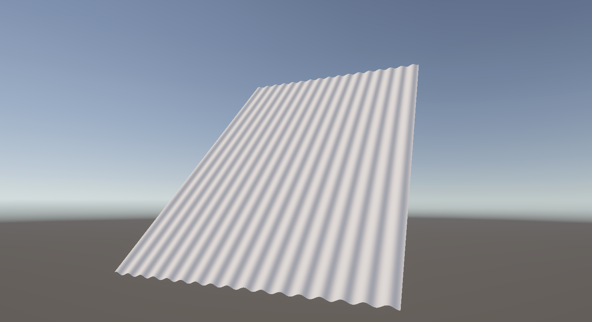

**Figure 7:** Cosine function applied along $\hat{d}$ to yield evenly spaced downwards running gullies

## Cell Splitting to avoid Gully Warping
Although this function applied to meshes of constant gradient gives clean looking, consistent gullies, when applied to irregular terrain with changing gradients, it becomes completely incoherent.

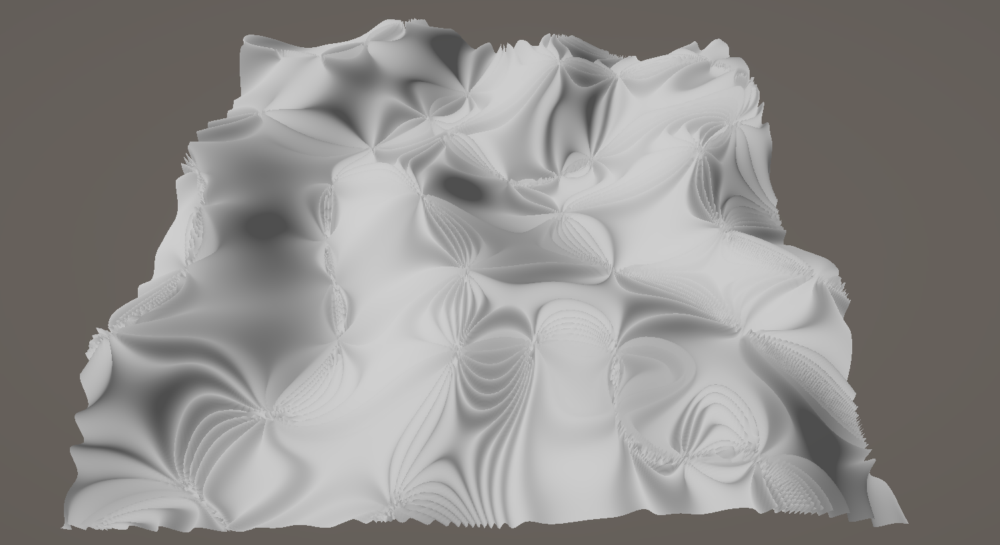

**Figure 8:** The warping of gullies as distance from pivot point $\vec{c}$ increases

The reason this occurs is because of the pivot point $\vec{c}$ defined earlier. Using one anchor for the dot product means that, as $\Vert \vec{o} \Vert$ increases, the dot product becomes more volatile. Similar to the arc lenght of a circle being proportional to the radius, a large $\Vert \vec{o} \Vert$ means that even a small difference in gradient results in a large difference in $\phi$. The solution involves splitting the terrain into discrete cells of cell size $h$, each with their own pivot point. This ensures that the distance from a pivot point will be less than the specified size of a cell. For future convenience, we can transform $\vec{p}$ and $\vec{c}$ so that, rather than being based on arbitrary world units, it is normalized with respect to the specified cell size $h$. In other words, $\tilde{\vec{p}} \equiv \vec{p}/h$ and $\tilde{\vec{c}} \equiv \vec{c}/h$. This means that the distance between two ends of a cell is 1. Using this, we obtain a cell identity vector $`\tilde{\vec{p}}_\text{cell} = \lfloor \tilde{\vec{p}} \rfloor`$,where $\lfloor \cdot \rfloor$ is applied component-wise. In this way, $`\tilde{\vec{p}}_\text{cell}`$ is unique for each cell, but shared by points within the same cell.

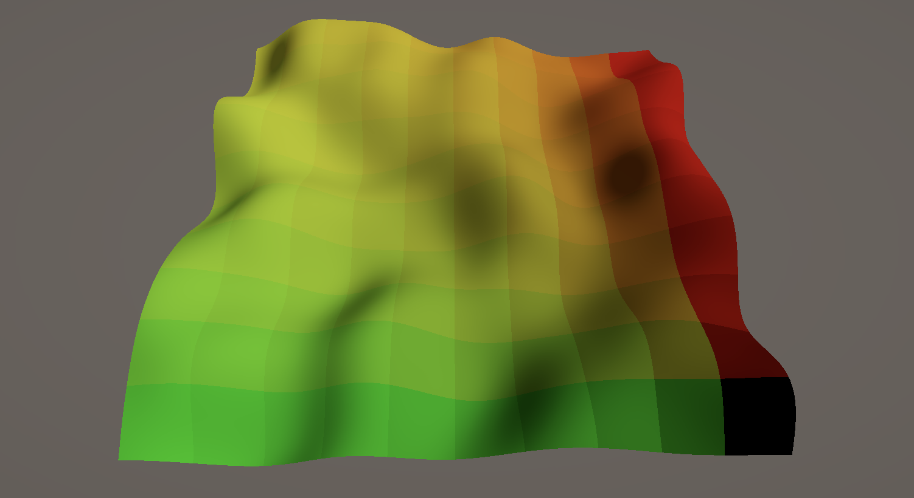

**Figure 9:** Visualizing $`\tilde{\vec{p}}_\text{cell}`$ through color, where red and green represent the x and y components of $`\tilde{\vec{p}}_\text{cell}`$ respectively

Geometrically, $\tilde{\vec{p}}_\text{cell}$ would be located in the very corner of the cell. Ideally, the pivot point would be located in the center to minimize potential difference in distance. Because $\tilde{\vec{p}}$ is normalized relative to the cell size, we can simply add $\langle 0.5, 0.5 \rangle$ to displace the position to the center, yielding:

$$\tilde{\vec{c}} = \lfloor \tilde{\vec{p}} \rfloor + \langle 0.5, 0.5 \rangle = \tilde{\vec{p}}_\text{cell} + \langle 0.5, 0.5 \rangle \quad (5)$$

Using Equation 3 and Equation 5, we can modify $\vec{o}$ to account for different pivot points and be with reference to the cell size.

$$\vec{o} \equiv \tilde{\vec{p}} - \tilde{\vec{c}} = \tilde{\vec{p}} - (\tilde{\vec{p}}_{cell} + \langle 0.5, 0.5 \rangle) \quad (6)$$

Applying the cell-splitting to the erosion algorithm yields non-warping gullies.

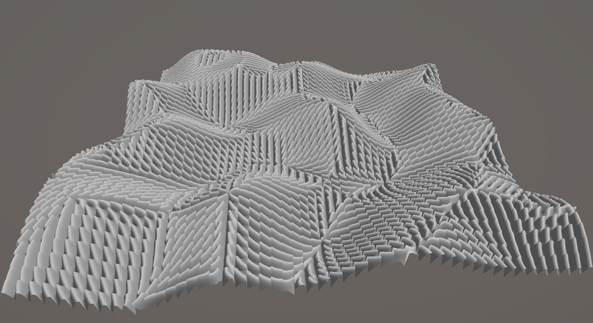

**Figure 10:** Applying the cell-based erosion function which yields non-warping gullies, but discontinuities between cell borders.

However, the borders between the cells become apparent. The discrete nature of the cells mean that at borders, the pivot will change, leading to a sudden phase shift. This creates the discontinuities seen in Figure 10.

## Blending Gullies

A useful property of sine and cosine waves is that multiple waves of different phases and amplitudes can be superimposed to create a single wave. As such, if we were to blend the waves of different cells it would result in a single continuous wave across multiple cells, eliminating the border discontinuities. This can be seen with the general relation:

$$\sum\limits_{n=1}^{k} a\cos(\phi _n) = A\cos(\Phi) \quad (7)$$

Where $A$ represents the resultant amplitude and $\Phi$ the resultant phase.

We can blend the gullies by summing the weighted average of $\cos(\phi)$ in neighboring cells based on the distance of that cell's pivot from $\tilde{\vec{p}}$. The weight $w$ can be determined using a Gaussian function so that $w$ decreases as distance from the cell pivot increases. A Gaussian function is a bell shaped function ideal for weight calcuations because it gives most importance to values near 0, with a smooth falloff as the magnitude of the input increases (“Gaussian Function”). The simplest such function, known as the standard Gaussian function, is:

$$\text{Gaussian}(r) = e^{-r^2} \quad (8)$$

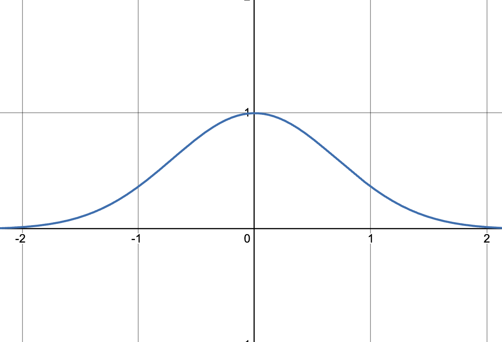

**Figure 11** Graphed Standard Gaussian function which yields a bell curve.

Here, $r$ represents the distance from the pivot, so that $r^2$ is the square distance. Because $\vec{o}$ denotes the vector displacement from the pivot point, $\vec{o} \cdot \vec{o}$ returns the square magnitude of $\vec{o}$ which represents the square distance from the pivot point ($r^2 \equiv \vec{o} \cdot \vec{o}$). Thus, using Equation 4 and Equation 8, we get an expression for erosion dependent on the weight $w$:

$$G(\vec{p}) = \cos(\phi) \cdot w \quad w \equiv e^{-(\vec{o} \cdot \vec{o})} \quad (9)$$

We can also get the gradient vector of $w$ using the chain rule, which will become important later in the final erosion function gradient vector.

$$\nabla w = -2\vec{o} \cdot e^{-(\vec{o} \cdot \vec{o})} = -2\vec{o} \cdot w \quad (10)$$

The process of blending involves iterating through the neighboring cells, adding the values of $\cos(\phi)$ as $\tilde{\vec{c}}$ changes for each cell, and averaging the final sum. As such, we must modify $E(\vec{p})$ to sum $\cos(\phi) \cdot w$ across neighbor cells. Because the pivot changes with the cell, $\vec{o}$ is dependent on the cell. Using Equation 5, we can express $\tilde{\vec{c}}$ with:

$$\tilde{\vec{c}}_{i, j} = \tilde{\vec{p}}_{cell} + \langle 0.5, 0.5 \rangle + \langle i, j \rangle \quad (11)$$

Where $i$ and $j$ are the $x$ and $y$ position components of the neighboring cells relative to the center cell respectively. This causes the erosion function can be expressed with:

$$G(\vec{p}) = \sum\limits_{i = -k}^{k} \sum\limits_{j = -k}^{k} \cos(\phi_{i, j}) \cdot w_{i, j} \quad (12)$$

Where $k$ is the number of cells which will be sampled in a direction from the center, so that a total of $(2k + 1)^2$ cells will be sampled ($k$ cells from the center in each direction plus the 1 center cell). $\phi_{i, j}$ is the phase with reference to the pivot point $c_{i, j}$, and $w_{i, j}$ is the weight based on the distance between $\tilde{\vec{p}}$ and $\tilde{\vec{c}}_{i, j}$.

With a large $k$, the erosion blends a large area of cells. At a certain distance, however, the distance weight becomes negligible so that the value of $k$ can be honed to blend as few cells as possible. This is ideal for a computer algorithm because it decreases the number of iterations and procedure length. However, setting $k$ too low would result in discontinuities as seen previously. The result of this implementation where $k = 2$ can be seen in the following Figure 12.

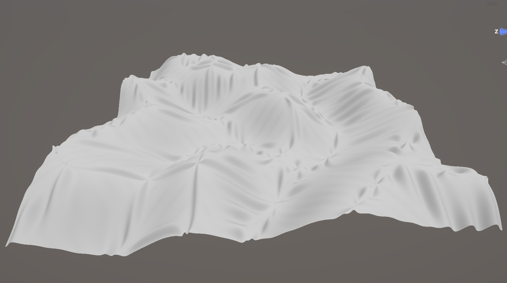

**Figure 12:** Gullies blended between cells by weight, with each point sampling from neighboring cells with $k = 2$.

### Normalizing Amplitude and Naturalizing Gully Pathways

The gullies now flow down the slopes continuously. However, as seen in Figure 12, the amplitudes of the gullies are inconsistent throughout the terrain, being much stronger when aligned with the $x$ and $z$ axis. This is because the superposition of cosine waves results in constructive and destruct interference based on the phase difference. In Equation 7, this is seen with the term $A$, which is not equivalent to $a$. This relationship also applies to sine waves so that we can define summation terms S and C:

$$\begin{gathered}S \equiv \sum\limits_{n=1}^{k} a\sin(\phi _n) = A\sin(\Phi) \\
  C \equiv \sum\limits_{n=1}^{k} a\cos(\phi _n) = A\cos(\Phi)
\end{gathered} \quad (13)$$

Determining $A$ gives us the normalization factor that can be applied to set the amplitude always to 1 (Tricard et al.), no matter the phase difference. We can use the Pythagorean Trigonmetric Identity to find this value.

$$\begin{gathered}S^2 + C^2 = A^2 \sin^2(\Phi) + A^2 \cos^2(\Phi) \\
= A^2 (\sin^2(\Phi) + \cos^2(\Phi)) \\
= A^2
\end{gathered}$$

so that

$$S^2 + C^2 = A^2 \quad (14)$$

This means we can use $S^2 + C^2$ to get A, so that $C/A$ and $S/A$ have an amplitude of 1. When evaluating $G(\vec{p})$, we now need the two summed values $C$ and $S$.

$$G(\vec{p}) = \frac{C}{\sqrt{S^2 + C^2}}, \quad
 S \equiv \sum\limits_{i = -k}^{k} \sum\limits_{j = -k}^{k} \sin(\phi_{i, j}) \cdot w_{i, j}, \quad
 C \equiv \sum\limits_{i = -k}^{k} \sum\limits_{j = -k}^{k} \cos(\phi_{i, j}) \cdot w_{i, j} \quad (15)$$

Therefore, we can obtain the gradient vectors $\nabla S$ and $\nabla C$ using the product rule.

$$\nabla S(\tilde{\vec{p}}) = \sum\limits_{i = -k}^{k} \sum\limits_{j = -k}^{k} 2\pi\cos(\phi_{i, k}) \cdot w_{i,j} \cdot \hat{d} + \sin(\phi_{i,j}) \cdot \nabla w_{i,j} \quad (16)$$

$$\nabla C(\tilde{\vec{p}}) = \sum\limits_{i = -k}^{k} \sum\limits_{j = -k}^{k} -2\pi\sin(\phi_{i, k}) \cdot w_{i,j} \cdot \hat{d} + \cos(\phi_{i,j}) \cdot \nabla w_{i,j} \quad (17) $$

Notably, we must multiply by $2\pi$ as part of the chain rule. Additionally, we multiply the vector $\hat{d}$ to apply the direction to gradient. Because $\sin(\phi)$ and $\cos(\phi)$ oscillate along the axis following $\hat{d}$, this is also the direction of the gradient.

Looking from above, the cosine gullies are clearly much more consistent across different gradients.

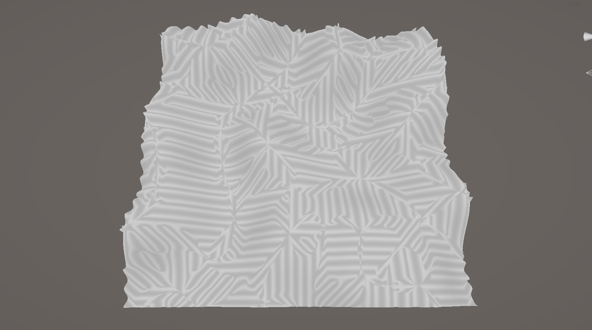

**Figure 13:** Gullies blended between cells by weight, with each point sampling from neighboring cells with $k = 2$ and amplitudes normalized to yield consistent amplitudes in all directions

However, the paths are still very straight and unnatural looking. Because the pivot points in each cell are spaced equally from each other, the pathways of the gullies tend to form aligned with the grid. To avoid this, we can simply offset $\tilde{\vec{c}}$ by a vector with randomly generated components so that there is slight variation in the pivot locations. The most effective way to do this is using a pseudo-random number function $H(\vec{v})$, which, given an input, will always return the same output with vector components between and including -1 to 1. How the function works will not be explained, but the important properties are that its output is not truly random, hence the term "pseudo-random". Specifically, the same input $\vec{v}$ will always yield the same output (Green). Still, there are no discernable patterns in the sequence and all values are equally represented. Thus, using $H(\vec{v})$, we can modify $\tilde{\vec{c}}$ to contain the cell-based pseudo-random offset.

$$\tilde{\vec{c}}_{i, j} = \tilde{\vec{p}}_{cell} + \langle i, j \rangle + \langle 0.5, 0.5 \rangle + A_H \cdot H(\tilde{\vec{p}}_{cell} + \langle i, j \rangle) \quad (18)$$

$A_H$ is the strength of the pseudo-random offset. $A_H = 0.5$ gives the greatest offset while still keeping the pivot inside the cell for all possible outputs.

Applying the offsets yields much more organic looking gullies with less predictable pathways.

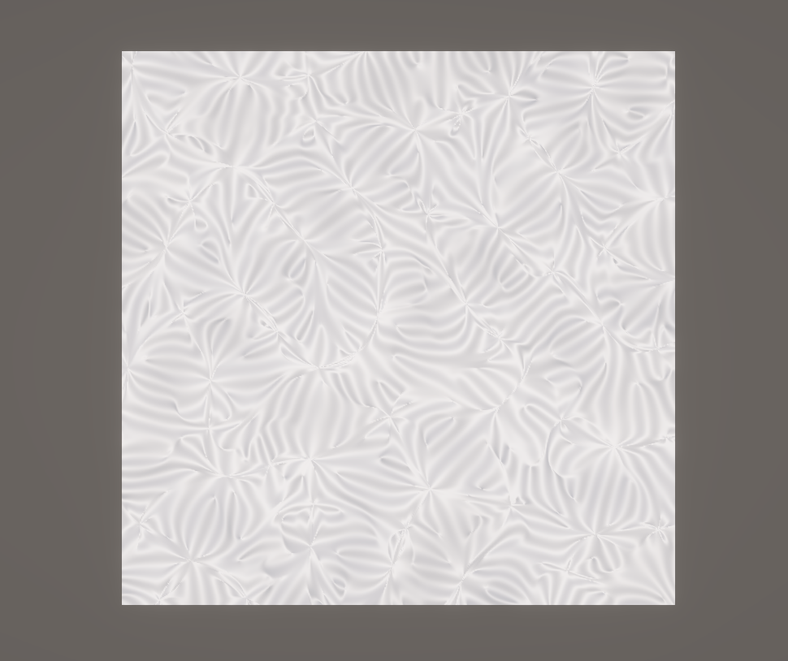

**Figure 14:** Gullies blended between cells by weight, with each point sampling from neighboring cells with $k = 2$, amplitudes normalized to yield consistent amplitudes in all directions, and pivots offset by a pseudo-random hash function to yield slight variation in gully pathways

## Addressing Peak/Valley Artifacts
Although the gullies look correct on sloped terrain, when they approach regions where the magnitude of $\vec{g}$ is near 0, they create unsightly artifacts.

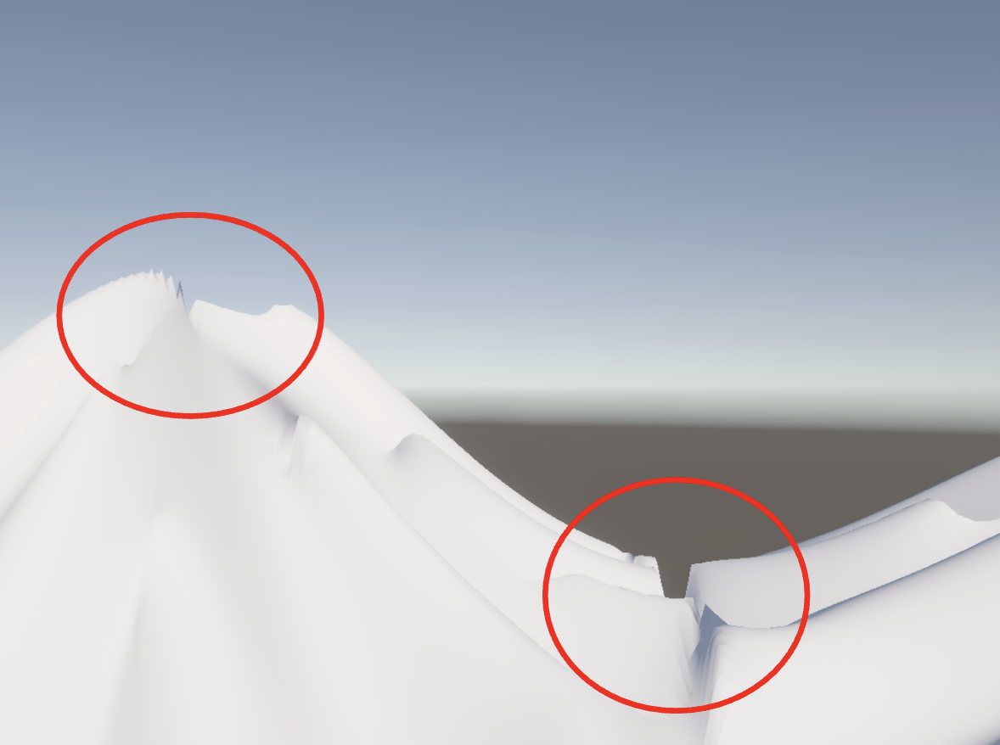

**Figure 15:** Discontinuities in areas where the gradient magnitude nears 0, resulting in gully artifacts present in terrain peaks, valleys, and saddles.

This has to do with the value of $\phi$, specifically the term $\hat{d}$ in $\vec{o} \cdot \hat{d}$. Because $\hat{d}$ is normalized, it retains the same magnitude even though the gradient magnitude decreases. On peaks, valleys, and saddles (where the gradient nears 0), $\vec{g}$ will change direction, causing $\hat{d}$ to flip abruptly. This results in discontinuities in $\phi$, creating the artifacts seen in Figure 14.

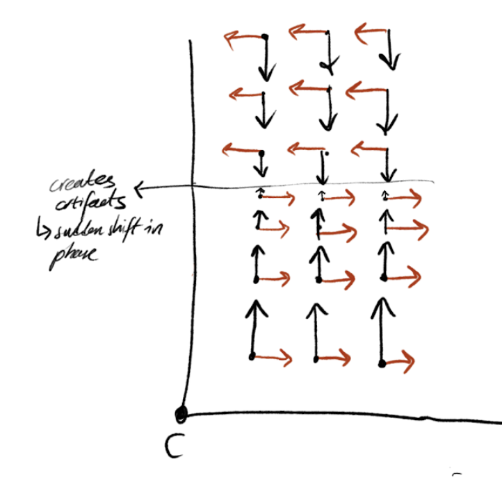

**Figure 16:** Visualizing the root of the peak/valley artifacts, which arise from the changing direction of $\vec{g}$

This effect can be mitigated by simply fading the erosion function where slopes near 0. If we take the final erosion function to be $E(\vec{p})$, it will return a prespecified target value where the slope magnitude is near 0, $G(\vec{p})$ where the slope is large, and linearly interpolate (lerp) between the values depending on the gradient magnitude. The general equation for lerp is:

$$\text{lerp}(v_0,v_1,t) = v_0(1 - t) + v_1 t \quad (19)$$

Where $v_0$ is the intial value, $v_1$ is the ending value, and $t$, ranging from [0, 1], is the weight between $v_0$ and $v_1$ (“Linear Interpolation”). Thus, we can represent the Erosion height with:

$$E(\vec{p}) = \text{lerp}(z_0, G(\vec{p}), t) \quad (20)$$

Where $z_0$ is the height target at small slopes.

### Deriving a Smoothstep Function

To determine the weight $t$, we could input $\vec{g}$ into a smoothstep function denoted as $\varphi$. Essentially, when $t = 0$, there is no erosion, and when $t = 1$, the erosion is at maximum strength. Using a smoothstep function allows $t$ to change continuously as $\vec{g}$ changes. The main property of the smoothstep function is that it ranges from $x=0$ to $x=1$, with $\varphi(0) = 0$ and $\varphi(1) = 1$, and $\varphi'(0) = 0$ and $\varphi'(1)= 0$, which yields a smooth relationship as the gradient changes (“smoothstep”). We can derive such a function using a third order polynomial.

$$\varphi(x) = ax^3 + bx^2 + cx + d$$

Because the $\varphi(0) = 0$, we know $d=0$.

$$\varphi(x) = ax^3 + bx^2 + cx$$

Knowing that the derivative at $x = 0$ and $x = 1$ is 0, we can find $a$, $b$, and $c$.

$$\begin{gathered}\varphi'(x) = 3ax^2 + 2bx + c = 0 \\
 \varphi'(0) = c = 0 \\
 \varphi'(1) = 3a + 2b = 0 \\
 \varphi(1) = a + b = 1
\end{gathered}$$

 Solving the system of equations yields $a = -2$ and $b = 3$ giving the base smoothstep function:

 $$\varphi(x) = 3x^2 -2x^3 \left\lbrace x|0 \leq x \leq 1 \right\rbrace \quad (21)$$

 Ideally, we should be able to customize the domain to have more control over the erosion fading. This can be done with an extra parameter $f_E$, which represents erosion falloff. Functionally, it increases the domain of the smoothstep, stretching the curve. This means that greater values of $f_E$ require $\vec{g}$ to be greater for the erosion strength to have a substantial effect. Additionally, for values of $x$ before the domain, the function should return 0, and for $x$ after the domain, it should return 1. We can express this in the smoothstep like so:

$$\varphi(x) = \left\lbrace \begin{array}{cl}
0 & : \ u < 0 \\
3u^2 -2u^3 & : 0 \leq u \leq 1 \\
1 & : \ u > 1
\end{array} \right.
\quad u \equiv \frac{x}{f_E} \quad (22)$$

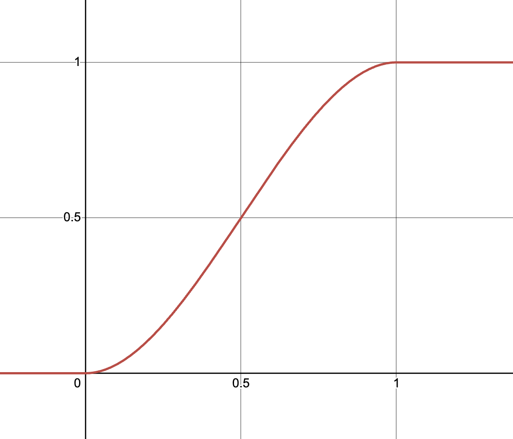

**Figure 17:** Graphing the smoothstep function $\varphi(x)$ with $f_E = 1$

We can use this to define the weight parameter $t$:

$$t(\vec{p}) = \varphi(\Vert \vec{g} \Vert ) \quad (23)$$

so that we get the final erosion layer function:

$$E(\vec{p}) = \text{lerp}(z_0, G(\vec{p}), \varphi(\Vert \vec{g} \Vert )) \quad (24)$$

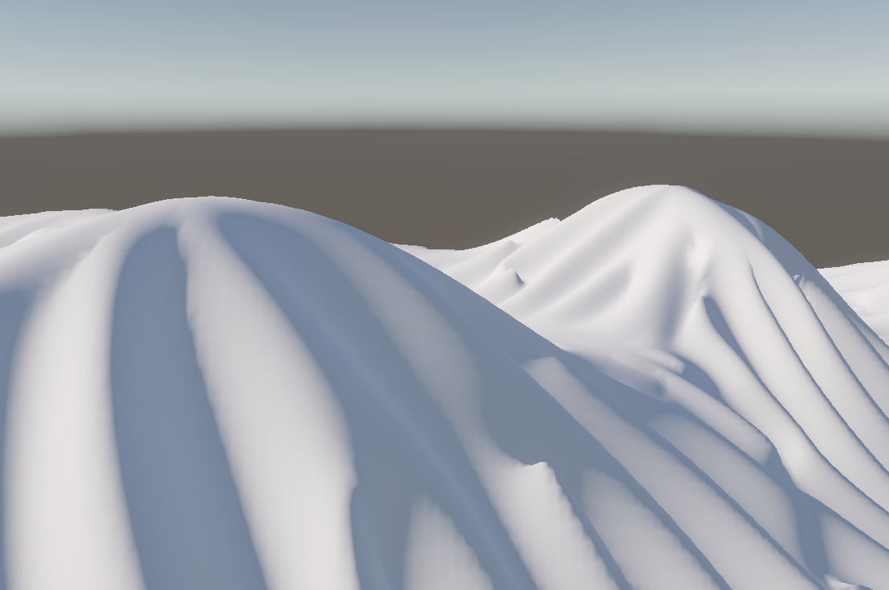

**Figure 18:** Applying erosion falloff, which removes the peak/valley artifacts and leaves the peaks smooth

## Obtaining the Analytical Derivatives

So far, $\vec{g}$ has represented the gradient of the base noise function, which is given. However, $E(\vec{p})$ changes the height of the terrain so that analytically calculating the derivatives must account for these changes. Getting the final derivative is essential in order to calculate lighting and layering multiple erosion layers, which will depend on the previous gradients as well.

### Deriving Base Gully Gradient $\nabla G$

First we can derive the equation for the gradient vector $\nabla G$, which represents the derivative of the base erosion gullies, not including the falloff factor.

To obtain $\nabla G$ we must differentate $G(\vec{p})$ from Equation 15 using Equation 16 and 17. We can simplify the derivation by defining a term $N$ so that

$$G(\vec{p}) = \frac{C}{N}, \quad N \equiv \sqrt{S^2 + C^2} \quad (25)$$

Using the quotient rule, differentiating G yields:

$$\nabla G(\vec{p}) = \frac{N \nabla C - C \nabla N}{N^2} \quad (26)$$

We can obtain the gradient vector $\nabla N$ with:

$$\begin{gathered}\nabla N = \frac{1}{2}(S^2 + C^2)^{-\frac{1}{2}} \cdot (2S\nabla S + 2C\nabla C) \\
= \frac{S\nabla S + C\nabla C}{N}
\end{gathered} \quad (27)$$

Substituting this in Equation 26 and multiplying the numerator and denominator by $N$ yields:

$$\nabla G = \frac{N^2 \nabla C - C(S\nabla S + C \nabla C)}{N^3} \quad (28)$$

Substituting $N^2$ gives:

$$\begin{gathered}\nabla G = \frac{(S^2 + C^2) \nabla C - CS \nabla S - C^2 \nabla C}{N^3} \\
 = \frac{S^2\nabla C + C^2 \nabla C - CS \nabla S - C^2 \nabla C}{N^3}
\end{gathered} \quad (29)$$

To which the two instances of $C^2 \nabla C$ in Equation 29 cancel out to yield the final gradient vector:

$$\nabla G = \frac{S^2 \nabla C - CS\nabla S}{N^3} \quad (30)$$

### Obtaining the Final Derivation for $\nabla E$
We can now derive a final relation for $E(\vec{p})$, which includes the gully falloff. Using Equation 19, we get:

$$\begin{gathered}E(\vec{p}) = \text{lerp}(z_0, G(\vec{p}), \varphi(\Vert \vec{g} \Vert )) = z_0(1 - t) + G \cdot t \\
 = t \cdot (G - z_0) + z_0
\end{gathered} \quad (31)$$

Thus, we can use the product rule to obtain the gradient vector.

$$\nabla E(\vec{p}) = t \cdot \nabla G + (G - z_0) \cdot \nabla t \quad (32)$$

Now, we need to determine $\nabla t$. For simplicity, we can define a scalar term $m(\vec{p}) \equiv \Vert \vec{g}(\vec{p}) \Vert$. 

$$\begin{gathered}t = \varphi(m) \\
\nabla t = \varphi'(m) \cdot \nabla m
\end{gathered} \quad (33)$$

$\varphi$ is a 1D function so we can use the prime notation. We can get $\varphi'$ using Equation 22.

$$\begin{gathered}\varphi = 3u^2 -2u^3 \\
 \varphi' = \frac{6u - 6u^2}{f_E} = \frac{6u(1 - u)}{f_E}
\end{gathered} \quad (34)$$

We must divide by $f_E$ as part of the chain rule, since $u = m/f_E$. Equation 34 can be substituted into Equation 33 to yield:

$$\nabla t = \frac{6u(1 - u) \nabla m}{f_E} \quad (35)$$

Keep in mind this is only the case for $0 < u < 1$, so $\nabla t$ is more accurately presented as:

$$\nabla t = \left\lbrace \begin{array}{cl}
\frac{6u(1 - u) \nabla m}{f_E} & : \ 0 \leq u \leq 1 \\
\vec{0} & : \ u < 0, u>1
\end{array} \right. \quad (36)$$

Returning to the definition of $m$, $\nabla m$ is the change in slope magnitude in the upward direction. Thus, we can approximate $\nabla m$ using finite differences, which is an approximation of the derivative based on the first principles of differentiation. The equation of differentation from first principles is:

$$f'(x) = \lim_{h\to 0} \frac{f(x + h) - f(x)}{h} \quad (37)$$

Finite differences takes h to be a small value $\epsilon$, so that $\nabla m$ is approximated as:

$$\nabla m \approx (\vec{g}(\vec{p} + \epsilon \cdot \hat{g}) - \vec{g}(\vec{p} - \epsilon \cdot \hat{g})) / 2\epsilon \quad (38)$$

Despite $\vec{g}$ being a 2D function, we only need to sample along one axis, namely the $\hat{g}$ direction because that is the upwards direction.

Thus, returning to Equation 32 and substituting the values, we get:

$$\nabla E(\vec{p}) = t \cdot \nabla G + \frac{6u} {f_E} (G - z_0) (1 - u) \cdot \nabla m \quad (39)$$

Which yields accurate gradients for the erosion gullies on top of the base terrain.

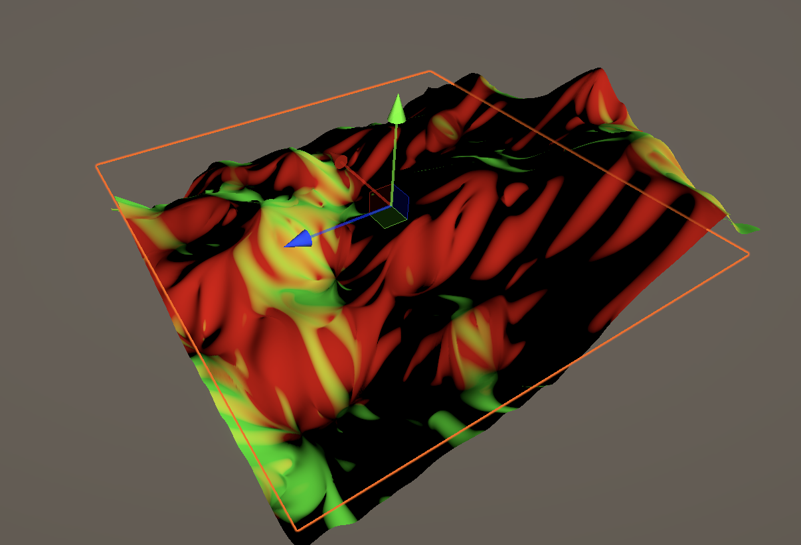

**Figure 19:** Visualizing the partial derivatives of the erosion function $E(\vec{p})$, with red and green representing $\delta x$ and $\delta y$ respectively

## Layering Erosion and Final Effects
What makes the erosion effect most convincing is the layering of the algorithm for multiple iterations. The first erosion function yields the results seen in Figure 19. When adding a second layer, the same algorithm can be applied with increasing $f$, decreasing $a$, and $\vec{g}$ being obtained from the previous erosion instance. This means that the additional layers will add a higher density of gullies with lower strength, which gives the affect of added detail. Because of the gullies' dependence on the terrain slope, multiple layers cause gullies to branch out in patterns highly remniscant with real-world terrain. 

|   |   |
|:---:|:---:|
| 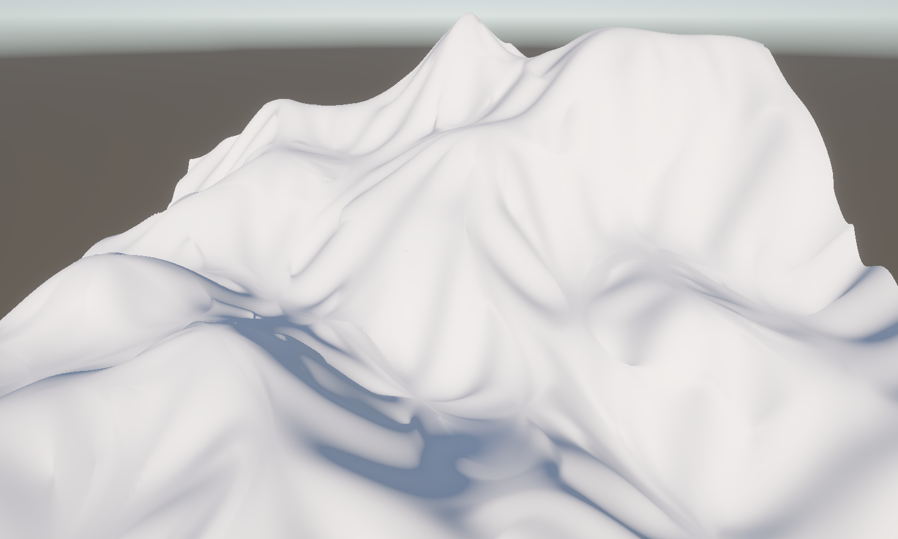 | 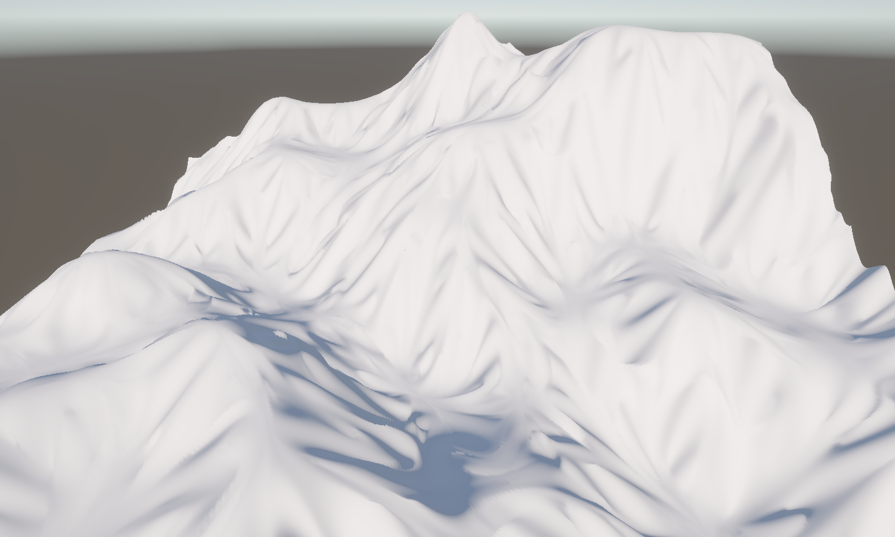 |
| (a) | (b) |
|  |  |
| (c) | (d) |

**Figure 20:** The resulting meshes when the erosion function $E(\vec{p})$ is passed (a) once, (b) twice, (c) three times and (d) four times

## Conclusion

This concludes the erosion-mimicking terrain function. This investigation was about obtaining a mathematical derivation for a convincing erosion height function, yet there still remains many more areas in this subject to explore. For instance, coloring the terrain to match that of mountains, adding foliage, blending biomes, and so on.

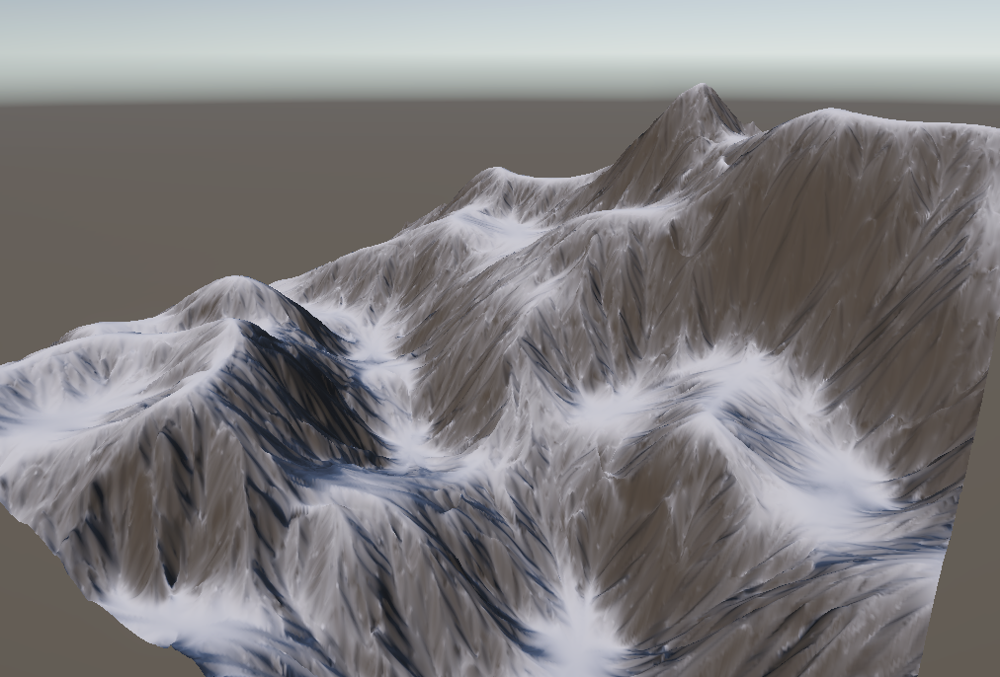

**Figure 21:** An example of using the terrain gradients to color the terrain, with flat regions colored white and steep regions colored brown.

The main drawback of such an approach for creating eroded terrain is that it does not actually simulate the erosion. This in itself is highly beneficial as stated in the introduction, yet still results in output not physically accurate. As such, many of the parameters are not based on the physics of erosion, but rather the design of the mimicking algorithm. Importantly, this algorithm utilizes analytical derivatives in contrast to finite differences. Analytical derivatives are able to produce more accurate results than finite differences, and are also much less computationally intensive. Finite differences are used in Equation 38 when calculating $\nabla m$. In this case, however, it only adds 2 extra calculations and allows us to avoid modelling a second derivative. Furthermore, analytical gradients for the gullies where $\hat{d}$ changes quickly are not accurate to the actual slope. This inaccuracy is mostly mitigated by simply fading the erosion near the slopes.

The erosion function can be further honed to create terrain that matches real-world even closer, for example, by sharpening peaks or adding sediment build up at the bases. In truth, there is not a set endpoint for such an endeavor; the algorithm can be continuously improved, and it is the job of the user to decide whether the results are satisfactory. Additionally, the results of this algorithm are highly dependent on the artistic choices of the user. Values like $f$, $A_E$, and $f_M$ to name a few do not have objectively optimal values, and must be decided by the user based on their personal preferences.

## References

Johansen, Rune Skovbo. “Fast & Gorgeous Erosion Filter Explained.” YouTube, uploaded by runevision, 30 Mar. 2026, www.youtube.com/watch?v=r4V21_uUK8Y. Accessed 15 Nov. 2026.

Doran, Jonathon, and Ian Parberry. “Controlled Procedural Terrain Generation Using Software Agents.” IEEE Transactions on Computational Intelligence and AI in Games, vol. 2, no. 2, June 2010, pp. 111–19, https://doi.org/10.1109/TCIAIG.2010.2049020.

Sharpe, Brian. “Simplex Noise.” briansharpe, 13 Jan. 2012, briansharpe.wordpress.com/2012/01/13/simplex-noise/.

“The Gaussian Function and Integral.” Mathematical Writing, course 401-3005-00L, ETH Zürich, Nov. 2025, metaphor.ethz.ch/x/2025/hs/401-3005-00L/models/paper_6_gauss.pdf. Accessed 15 Nov. 2026.

Tricard, Thibault, et al. “Procedural Phasor Noise.” ACM Transactions on Graphics, vol. 38, no. 4, July 2019, article 57, https://doi.org/10.1145/3306346.3322990.

Green, Matthew. “PRFs, PRPs and Other Fantastic Things.” A Few Thoughts on Cryptographic Engineering, 8 May 2023, blog.cryptographyengineering.com/2023/05/08/prfs-prps-and-other-fantastic-things/.

“Linear Interpolation.” ScienceDirect Topics: Computer Science, Elsevier, www.sciencedirect.com/topics/computer-science/linear-interpolation. Accessed 15 Nov. 2026.

“smoothstep — Perform Hermite Interpolation between Two Values.” OpenGL Reference Pages, Khronos Group, 2014, registry.khronos.org/OpenGL-Refpages/gl4/html/smoothstep.xhtml. Accessed 15 Nov. 2026.